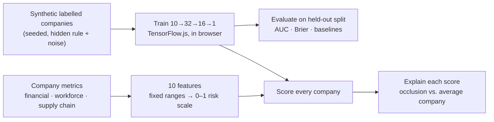

# Market Exit Risk Predictor

[](https://github.com/kilobyte23/market-risk-predictor/actions/workflows/ci.yml)
[](LICENSE)

**A neural network that trains in your browser, scores how likely each company is to exit its market, and explains why.**

The dashboard ranks companies by model-predicted exit risk and breaks each score down by the metric driving it. It pairs that with rule-based risk alerts, news sentiment and an industry peer comparison. Everything runs client-side with TensorFlow.js, with no backend.

> Companies, news and training data are **fictional or synthetic**. This is an ML engineering showcase, not financial advice. See [Limitations](#limitations).

## Results

On a held-out test set of 600 synthetic companies the model never trained on:

| Scorer | ROC AUC | What it means |
| --- | --- | --- |
| Unweighted average of the 10 risk features | 0.82 | What you get without learning |
| **Neural network (this project)** | **0.85** | Learns which metrics matter, and their interaction |
| The hidden rule that generated the labels | 0.86 | The ceiling: labels are noisy, so no model can reach 1.0 |

The network closes about 75% of the gap between the naive score and the best possible one. Its Brier score is about 0.11, and test accuracy is about 85% against a 79% "always predict no exit" baseline. These numbers are asserted in [`model.test.ts`](src/ml/model.test.ts) and shown live in the app after every training run.

## How it works



1. **Features** ([`features.ts`](src/ml/features.ts)): debt ratio, current ratio, revenue growth, profit margin, interest coverage, layoffs as a share of staff, staff turnover, hiring freeze, supplier diversity and geographic supply risk. Each maps to a 0–1 risk scale using **fixed** ranges, so a company scores the same no matter which other companies are loaded.
2. **Training data** ([`dataset.ts`](src/ml/dataset.ts)): 3,000 seeded synthetic companies. The labels come from a hidden logistic rule plus a distress interaction term. Revenue decline, losses and layoffs matter most, and several metrics barely matter, so a model has to *learn the weights* to beat a plain average.
3. **Model** ([`model.ts`](src/ml/model.ts)): a dense 10 → 32 → 16 → 1 network with dropout and a sigmoid output, using Adam and binary cross-entropy. It trains on TensorFlow.js's CPU backend, which is faster than WebGL for a network this small, and yields to the UI between epochs.
4. **Explanations**: for each company, each feature is reset to the training-set mean and the change in exit probability is measured. The result is a signed, per-company "what drives this score" chart.

## Features

- Companies ranked by **model-predicted exit risk**, with financial, workforce and supply-chain health scores
- **Company detail**: exit probability, risk band and timeframe, a factor breakdown, and a 90-day price chart
- **Risk alerts** derived by rules from each company's metrics: negative cash flow, interest coverage under 1.5×, layoffs of 10% or more, leadership departures, dependence on a risky supplier, and negative press
- **News sentiment** for each company, using the `sentiment` library with a finance lexicon (for words like "layoffs", "downgrade" and "beats")
- **Peer comparison**: a radar chart and table against companies in the same industry
- Live training curves (training and validation loss), and a retrain button

## Model card

| | |
| --- | --- |
| **Task** | Binary classification: will the company exit its market? |
| **Inputs** | 10 normalised metrics (above) |
| **Training data** | 3,000 synthetic companies, seeded (default seed 42). About 20% positive |
| **Evaluation** | 20% held-out split. ROC AUC, accuracy against the majority baseline, Brier score, plus heuristic and oracle AUC for context |
| **Explainability** | Occlusion against the mean training company, per prediction |
| **Intended use** | Demonstrating an end-to-end ML product: features, training, evaluation, explanation and UI |
| **Not for** | Investment or employment decisions |

## Limitations

- **Synthetic labels.** The model learns a rule that we wrote. Real exits depend on far more than 10 metrics, and real labels are rare and messy.
- **Six fictional companies.** The data layer is a TanStack Query `queryFn` returning [`mockData.ts`](src/mockData.ts). To use real data, return the same `Company` shape from an API. SEC EDGAR XBRL financials are a natural source.
- **Occlusion explanations** show sensitivity, not causation. Correlated features can share credit.

## Getting started

```bash
npm install
npm run dev        # http://localhost:5173
```

| Command | Description |
| --- | --- |
| `npm run dev` | Dev server |
| `npm test` | Model, dataset and metric tests (Vitest) |
| `npm run lint` | ESLint |
| `npm run build` | Type-check and production build |

Deploys as a static site: `npm run build` outputs `dist/`, which runs on Vercel, Netlify or GitHub Pages.

## Tech stack

React 18, TypeScript, Vite, Tailwind CSS, TensorFlow.js, TanStack Query, Recharts, `sentiment`, Vitest

## Project structure

```
src/
  App.tsx                 Dashboard, company detail, alerts
  components/             ModelTraining, MarketSentiment, CompetitorAnalysis
  analysis/               Rule-based alerts and news sentiment
  ml/features.ts          Company metrics → 10 model inputs
  ml/dataset.ts           Seeded synthetic companies, hidden labelling rule, split
  ml/model.ts             Train, evaluate (AUC, Brier, baselines), predict, explain
  ml/useRiskModel.ts      React hook: train once, score every company
  mockData.ts, types.ts   Fictional companies and news, shared types
```

## License

[MIT](LICENSE)
